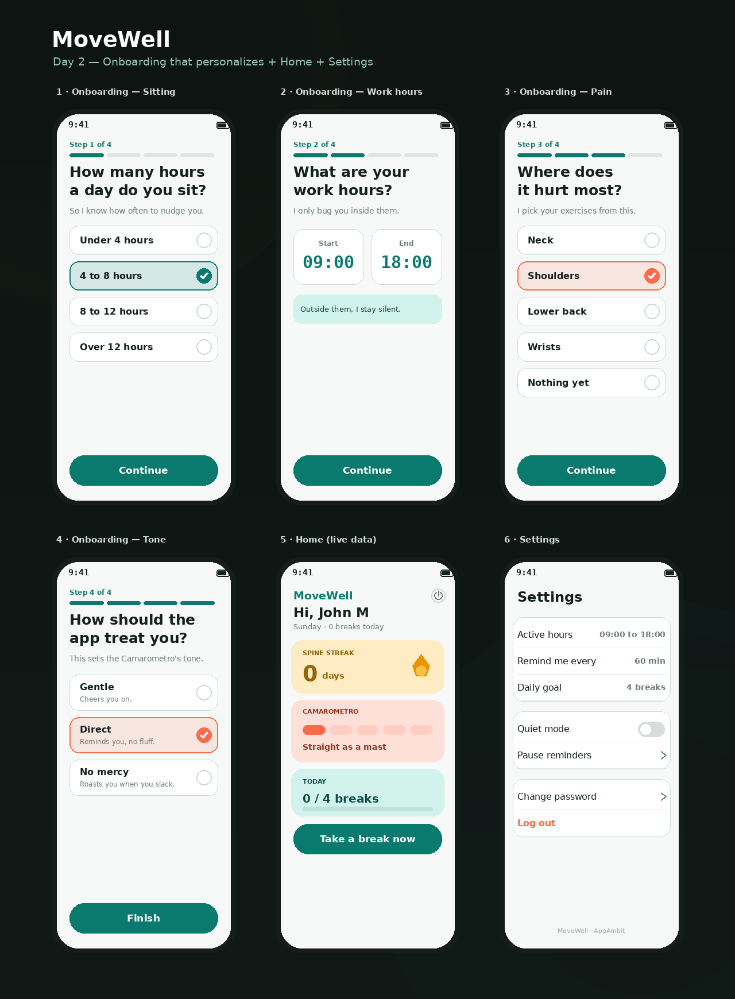

# DESIGN.md — MoveWell UI reference

This file is the visual contract for the app's screens. When a prompt says "follow
DESIGN.md", build the screen to match the layout, elements and states described here.
The rendered mockup lives at `docs/design/day2_screens.png`. All app copy is in English.

**Rules that always apply** (see `CLAUDE.md`): Riverpod + MVVM + go_router, `setState`
forbidden, colors from `Theme.of(context).colorScheme` (never hardcoded hex). This file
describes *what* each screen shows; `CLAUDE.md` and the palette below describe *how*.

## Palette (from `lib/core/theme/app_colors.dart`)
- **Teal** (`primary`) — health, movement, "take a break" / primary actions.
- **Coral** (`secondary`) — the shrimp side: Camarometro, Posture Roast, warnings.
- **Amber** (`tertiary`) — Spine Streak and achievements.
- Light theme surfaces: background `#F6F9F8`, surface white, text `#13201E`, muted
  `#5A6B68`, outline `#C3D0CD`. All screens are light theme.

Product names stay as-is (English-based brand terms): **Spine Streak**, **Camarometro**,
**Posture Roast**, **Office Shrimp**.

## Mockup

Six screens: the 4-question onboarding, the Home, and Settings. Each onboarding answer
seeds one field of `user_settings` — see the deterministic map in the plan
(`../../MARKETING/Ideas/PLAN.md`, sections **1.4 / 1.4.1** and **Apéndice D**).

---

## Screen → feature map

| # | Screen | Feature folder | Backend it uses |
|---|---|---|---|
| 1–4 | Onboarding (4 questions) | `lib/features/onboarding/` | `save_onboarding` |
| 5 | Home | `lib/features/home/` | `get_user_stats` (Day 1) |
| 6 | Settings | `lib/features/settings/` | `update_settings`, `auth_change_password` |

---

## 1–4 · Onboarding (feature: `onboarding`)
A 4-step flow. Each step: a small progress indicator ("Step N of 4" + a 4-segment bar),
a bold question title, a one-line muted subtitle, tappable answer options, and a primary
teal button ("Continue", "Finish" on the last). Questions and copy come from the CMS with a
local fallback; answers are collected in the view model and sent **once** at the end via
`save_onboarding`. Nothing is derived on the client — the server seeds `user_settings`
(see PLAN 1.4.1).

- **P1 · "How many hours a day do you sit?"** — single choice: `Under 4 hours` (`0-4`) /
  `4 to 8 hours` (`4-8`) / `8 to 12 hours` (`8-12`) / `Over 12 hours` (`12+`). Subtitle: "So I
  know how often to nudge you." Neutral (sitting, not just screen time). Answer key is
  `sitting_hours`. Seeds `reminder_interval_min` + `daily_goal` + `archetype`.
- **P2 · "What are your work hours?"** — two time fields, Start (default 09:00) and End
  (default 18:00), shown as large teal values, with a teal note: "Outside them, I stay
  silent." Seeds `active_start` / `active_end`.
- **P3 · "Where does it hurt most?"** — single choice list: `Neck` (`neck`) /
  `Shoulders` (`shoulders`) / `Lower back` (`lower_back`) / `Wrists` (`wrists`) /
  `Nothing yet` (`none`). Subtitle: "I pick your exercises from this." Seeds `pain_zone`
  (drives the exercise set in Day 3).
- **P4 · "How should the app treat you?"** — single choice with a one-line descriptor each:
  `Gentle` ("Cheers you on.", `gentle`), `Direct` ("Reminds you, no fluff.", `direct`),
  `No mercy` ("Roasts you when you slack.", `no_mercy`). Subtitle: "This sets the
  Camarometro's tone." Seeds `roast_threshold` (5 / 3 / 2).

Selected state: filled tint of the accent + 2px accent border + a filled check on the right.
Unselected: white surface, 1px outline, empty circle. Accent is teal for P1/P2, coral for P3/P4.

## 5 · Home (feature: `home`)
Already built in Day 1 to read `user_stats`. Layout the design targets:
- App bar: "MoveWell" (teal) with a logout affordance on the right.
- Greeting "Hi, {name}" + muted line "{weekday} · {breaks_today} breaks today".
- **Spine Streak** card (amber container): label "SPINE STREAK", big `current_streak`
  + "days", flame accent.
- **Camarometro** card (coral container): label, a 5-segment meter filled to `roast_level`
  (0–5), and a caption describing the level (e.g. "Straight as a mast" at 0).
- **Today** card (teal container): "{breaks_today} / {daily_goal} breaks" + a progress bar.
- Primary teal button "Take a break now" (wired; break screen is Day 3).

## 6 · Settings (feature: `settings`)
Grouped rows on white cards. Each row edits `user_settings` via `update_settings` (except
password and logout):
- Group 1: "Active hours" → `09:00 to 18:00` · "Remind me every" → `60 min` · "Daily goal"
  → `4 breaks`. (Values come from the user's row; these are editable.)
- Group 2: "Quiet mode" → toggle for `quiet_mode` (per-user, NOT global Remote Config): when
  on, reminders arrive silently (low priority, no sound/banner), still logged and counted ·
  "Pause reminders" → opens options that set `paused_until` (sick or on vacation).
- Group 3: "Change password" (→ `auth_change_password`, needs the old password) ·
  "Log out" (coral, clears the token → Log In).

States for every screen: idle / loading (disable the primary button, show a spinner) /
error (show the backend message). No placeholder data — always the logged-in user's row.
