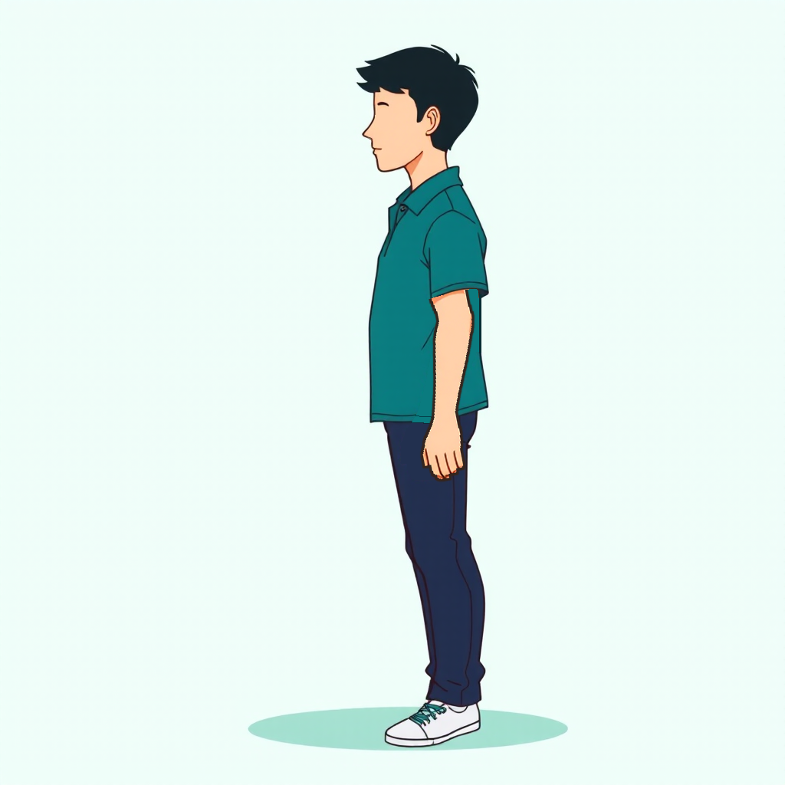
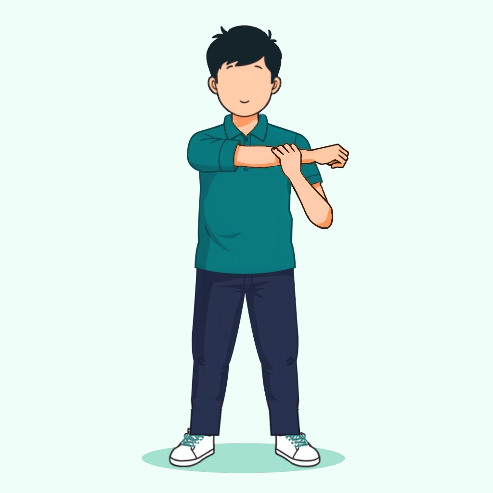

# DESIGN.md — Unshrimp UI reference

This file is the visual contract for the app's screens. When a prompt says "follow
DESIGN.md", build the screen to match the layout, elements and states described here.
The rendered mockup lives at `docs/design/day2_screens.png`. All app copy is in English.

**Rules that always apply** (see `CLAUDE.md`): Riverpod + MVVM + go_router, `setState`
forbidden, colors from `Theme.of(context).colorScheme` (never hardcoded hex). This file
describes *what* each screen shows; `CLAUDE.md` and the palette below describe *how*.

## Palette (from `lib/core/theme/app_colors.dart`)
- **Teal** (`primary`) — health, movement, "take a break" / primary actions.
- **Coral** (`secondary`) — the shrimp side: Spine Battery, Posture Roast, warnings.
- **Amber** (`tertiary`) — Spine Streak and achievements.
- Light theme surfaces: background `#F6F9F8`, surface white, text `#13201E`, muted
  `#5A6B68`, outline `#C3D0CD`. All screens are light theme.

Product names stay as-is (English-based brand terms): **Spine Streak**, **Spine Battery**,
**Posture Roast**, **Office Shrimp**.

## Mockup


Six screens: the 4-question onboarding, the Home, and Settings. Each onboarding answer
seeds one field of `user_settings` — see the deterministic map in the plan
(`../../MARKETING/Ideas/PLAN.md`, sections **1.4 / 1.4.1** and **Apéndice D**).

---

## Screen → feature map

| # | Screen | Feature folder | Backend it uses |
|---|---|---|---|
| 1–4 | Onboarding (4 questions) | `lib/features/onboarding/` | `save_onboarding` |
| 5 | Home | `lib/features/home/` | `get_user_stats` (Day 1) |
| 6 | Settings | `lib/features/settings/` | `update_settings`, `auth_change_password` |

---

## 1–4 · Onboarding (feature: `onboarding`)
A 4-step flow. Each step: a small progress indicator ("Step N of 4" + a 4-segment bar),
a bold question title, a one-line muted subtitle, tappable answer options, and a primary
teal button ("Continue", "Finish" on the last). Questions and copy come from the CMS with a
local fallback; answers are collected in the view model and sent **once** at the end via
`save_onboarding`. Nothing is derived on the client — the server seeds `user_settings`
(see PLAN 1.4.1).

- **P1 · "How many hours a day do you sit?"** — single choice: `Under 4 hours` (`0-4`) /
  `4 to 8 hours` (`4-8`) / `8 to 12 hours` (`8-12`) / `Over 12 hours` (`12+`). Subtitle: "So I
  know how often to nudge you." Neutral (sitting, not just screen time). Answer key is
  `sitting_hours`. Seeds `reminder_interval_min` + `daily_goal` + `archetype`.
- **P2 · "What are your work hours?"** — two time fields, Start (default 09:00) and End
  (default 18:00), shown as large teal values, with a teal note: "Outside them, I stay
  silent." Seeds `active_start` / `active_end`.
- **P3 · "Where does it hurt most?"** — single choice list: `Neck` (`neck`) /
  `Shoulders` (`shoulders`) / `Lower back` (`lower_back`) / `Wrists` (`wrists`) /
  `Nothing yet` (`none`). Subtitle: "I pick your exercises from this." Seeds `pain_zone`
  (drives the exercise set in Day 3).
- **P4 · "How should the app treat you?"** — single choice with a one-line descriptor each:
  `Gentle` ("Cheers you on.", `gentle`), `Direct` ("Reminds you, no fluff.", `direct`),
  `No mercy` ("Roasts you when you slack.", `no_mercy`). Subtitle: "This sets how fast
  your Spine Battery drains." Seeds `roast_threshold` (5 / 3 / 2).

Selected state: filled tint of the accent + 2px accent border + a filled check on the right.
Unselected: white surface, 1px outline, empty circle. Accent is teal for P1/P2, coral for P3/P4.

## 5 · Home (feature: `home`)
Already built in Day 1 to read `user_stats`. Layout the design targets:
- App bar: "Unshrimp" (teal) with a logout affordance on the right.
- Greeting "Hi, {name}" + muted line "{weekday} · {breaks_today} breaks today".
- **Spine Streak** card (amber container): label "SPINE STREAK", big `current_streak`
  + "days", flame accent.
- **Spine Battery** card (coral container): label + charge percent, a 5-segment meter
  filled to the charge (`5 - roast_level`, so full at `roast_level` 0), and a caption by
  charge (e.g. "Fully charged" at 100%, "Dead. Stretch to recharge." at 0%).
- **Today** card (teal container): "{breaks_today} / {daily_goal} breaks" + a progress bar.
- Primary teal button "Take a break now" (wired; break screen is Day 3).

## 6 · Settings (feature: `settings`)
Grouped rows on white cards. Each row edits `user_settings` via `update_settings` (except
password and logout):
- Group 1: "Active hours" → `09:00 to 18:00` · "Work days" → the weekdays the user works
  (`Mon, Tue, …` or `Every day`), edited in a sheet with one toggle per day, Mon first, at
  least one on · "Remind me every" → `60 min` · "Daily goal" → `4 breaks`. (Values come from
  the user's row; these are editable. Work days is `active_days`; reminders and the streak
  skip the days that are off.)
- Group 2: "Quiet mode" → toggle for `quiet_mode` (per-user, NOT global Remote Config): when
  on, reminders arrive silently (low priority, no sound/banner), still logged and counted ·
  "Pause reminders" → opens options that set `paused_until` (sick or on vacation).
- Group 3: "Change password" (→ `auth_change_password`, needs the old password) ·
  "Log out" (coral, clears the token → Log In).

States for every screen: idle / loading (disable the primary button, show a spinner) /
error (show the backend message). No placeholder data — always the logged-in user's row.

---

## 7 · History (feature: `history`)
The per-day record, reached from a chart icon on the Home app bar. Reads `get_stats_history`
through the read cache, so it opens offline with the last thing it saw (same Offline chip as
Home). **Free** sees today's card and the weeks **blurred** behind an "Unlock your history ·
Pro" lock that opens the Pro screen; **Pro** sees the full weeks. The server enforces this —
`get_stats_history` returns only today for Free (`is_pro:false`). Layout (Pro):
- App bar: "History", with the Offline chip when serving cached data.
- **Today** card on top (teal container): today's `breaks / daily_goal` and a check when met.
- **Summary** row: **best streak** (amber, longest run of goal-met days in the window) and
  **days goal met** in the window.
- **One card per week**, newest on top. Up to three recent weeks are read, and a week with no
  activity at all is hidden, so the screen never shows a row of empty days. Each card has a
  header (date range, with the ignored-reminders count on the right in coral) and **one row
  per day**, oldest on top:
  - A bar that **fills toward the daily goal** (`breaks / daily_goal`, capped full) with the
    day's `breaks / goal` and a check once met. Fill: **met** → teal (`primary`); **partial**
    → amber (`tertiary`); **missed** → empty track. The filling bar is deliberate — progress
    toward the goal reads as a small reward a status dot could not convey.
  - A **rest day** (a weekday the user does not work, from `active_days`) shows a muted
    "Rest day" row with a moon icon, no bar and no count — never a missed-goal bar. Rest days
    are skipped by the streak server-side: a goal met before and after bridges across them.
- Empty window (new user) shows no week cards, never a blank screen or placeholder data.

---

## 8 · Pro / Subscriptions (feature: `subscriptions`)

A 14-day Pro trial, decided entirely in the cloud (`get_entitlements`), shown where each Pro
thing lives — locks, not a wall. All copy in English; the word "server" never appears. Palette:
**teal** = a healthy trial / paid Pro; **amber** (`tertiary`) = the trial is almost over;
**coral** (`secondary`) = the Pro lock tag.

- **Trial started** (`trial_started`, shown once right after onboarding): a full screen —
  premium icon, "Your N-day Pro trial has started", the three benefits each with a teal check,
  the line "No card needed. After N days you keep the basics for free.", a primary **"Start my
  trial"** and a close **X** (both → Home), and a secondary **"Subscribe now"** (→ Pro). N is
  the real trial length. The route marks itself shown, so it never reappears.
- **Home status pill** (under the greeting, opens Pro): teal **"Pro trial · N days left"**;
  amber **"Trial ends in N days"** when N ≤ `trial_warning_days`; **"Free plan · See Pro"** when
  Free; **"Pro"** when paid.
- **Locks** (coral tag, tap → Pro): under the break's exercise a row **"More exercises for your
  {zone} · Pro"** (Free only; never interrupts a break in progress); History weeks blurred with
  **"Unlock your history · Pro"**.
- **Pro screen** (`pro`): title **"Unshrimp Pro"**; the trial line ("Your trial ends Oct 30" /
  "Your trial ended" / "You're on Unshrimp Pro"); three benefit rows (all exercises for your
  pain zone, your full history, your weekly Spine Report); the honest line "Free keeps reminders,
  the Posture Roast, the Spine Battery and your streak."; two plan cards — **Monthly** and
  **Yearly** (Yearly tagged **Best value**, selected by default) — with prices from Remote
  Config `pro_price_labels`; a **Subscribe** button (spinner while buying, screen ignores taps);
  Terms and Privacy links. Purchases go through a `PurchaseService.buy(plan)` returning
  purchased / cancelled / failed; until the store is connected the default returns **failed** and
  the screen shows "Purchases open soon. Your trial keeps everything unlocked."
- **Welcome modal** (on `purchased`): a check, "Welcome to Unshrimp Pro", the three benefits,
  and **"Let's go"** — which refreshes `get_entitlements` bypassing the cache and returns the
  user to where they were.
- **Trial-ended sheet** (bottom sheet, shown once on the next open after the trial lapses): "Your
  Pro trial ended", what stays free and what is now Pro, with **"See Pro"** and **"Continue
  free"**. Dismissible — not a wall.
- **Trial-warning notification**: one local notification `trial_warning_days` before
  `trial_ends_at` with `trial_warning_text`, scheduled the same way reminders are (re-armed after
  each reschedule).
- **Offline**: a Pro user with no network stays Pro for `entitlement_grace_days`; past that it
  reads as Free.

---

## Exercise character (illustrations in `assets/dataset/media/`)

Every exercise still shows **the same character**. The pose is the only thing that changes
between images. Two 1024x1024 references, same person:

- **Profile master**: `docs/design/exercise_character.png`, shipped as
  `assets/dataset/media/chin-tuck-hold-main.webp`.
- **Front reference**: `docs/design/exercise_character_front.png`, shipped as
  `assets/dataset/media/cross-body-shoulder-stretch-main.webp`. Use it for every pose that
  faces the viewer (head, torso, legs and shoes stay as they are; only the arms change).




### Hard rules (check every image before showing it; the user must never have to repeat these)

1. **No eyes. Ever.** No eye, no closed-eye stroke, no eyelash, no pupil, in any pose and
   any view. A short dark stroke at eye height reads as a closed eye, so it counts as an
   eye. When the model redraws a face it always adds one: the guide must carry no stroke at
   eye height, and after every pass zoom the face to 4x and erase whatever is there.
2. **Same build as the approved images, never thinner.** At 1024: torso about 150px deep
   in profile and 195px wide from the front, thigh 75-78px, calf 56-60px, arm 42px at the
   sleeve and 25px at the wrist. The model slims the figure when it redraws it and the pose
   references are thin athletes: copy the pose from the reference, never its body. Measure
   torso, thigh and arm in the result against these numbers before showing it.
   **Limbs keep their length in every pose and every direction** (hanging, raised or
   stretched forward): arm = 226-246px of skin visible past the sleeve hem and 310-334px
   from the shoulder joint to the fingertips; thigh about 185px (hip to knee); lower leg
   158px (knee to trouser hem) plus the shoe. Not shorter and not longer: all limbs
   proportional to the approved images. In a guide, the arm piece starts **at the sleeve
   hem**, never under the sleeve (that hides 40px and gives short arms). Measure the arm
   in the result and compare with mountain pose (228) and chin tuck (246) before showing.
3. **Same hair**: black `#15242B`, the master's cut with the fringe.
4. **Same clothes**: teal polo with short sleeves, navy trousers down to the shoe (no bare
   ankle), white sneakers with teal laces.
5. **Same hands**: both the same size, complete, shaped as in the reference pose.
6. Compare the result at real size next to two approved images and next to the reference,
   part by part, before showing it. If it does not pass, fix it first.

### Identity (never changes)

| Part | Spec | Color |
|---|---|---|
| Hair | Short, **black**. Full on top, pointed fringe swept forward over the forehead, a few loose strands at the crown, tapered nape, ear uncovered. | `#15242B` |
| Face | **No eyes.** The approved references keep what they have (profile: nose, small mouth line, one ear; front: a small smile, both ears). In any new or redrawn face, nothing at eye height: no brow, no stroke. | skin |
| Skin | Flat fill, darker tone only as the shadow under the sleeve. | `#FFD1AB`, shadow `#F19263` |
| Shirt | Teal short-sleeve polo with collar and 2-button placket. Loose fit, sleeve ends above the elbow, hem at the hip covering the waistband. | `#0A7B7F` |
| Trousers | Navy, slim straight leg, full length down to the shoe. No belt, no cuffs. | `#22304F` |
| Shoes | White low-top sneakers with teal laces. | `#F1EFF4` |
| Outline | Thin dark line (about 3px at 1024). Brown-black around skin, dark teal on the shirt, dark navy on the trousers. | `#34241C` skin line |
| Background | Flat pale mint, one oval floor shadow under the feet. No props, no mat, no text. | `#F0FEF9`, shadow `#A5E1D0` |

### Proportions (1024 master, standing)

- Figure height: hair top at y=59, sole at y=973, so the body takes **89% of the canvas
  height**. Keep this height in every standing pose so the character does not grow or shrink.
- About **5 heads tall** (head and hair = 186px). Shirt from y=220 (collar) to y=551 (hem).
  Trousers from the hem to y=918. Shoes below that.
- Torso width in profile: 150px. Arm width: 48px at the sleeve, 36px at the wrist.
- Horizontally centered. Floor shadow oval about 415px wide, centered under the feet.

### Pose rules

- A hanging arm is **straight**: vertical from the sleeve to the hand, no bend at the elbow,
  hand relaxed beside the thigh with the fingers pointing down. Never in a pocket.
- **Shoulders and sleeves follow the arm.** The sleeve is a tube around the upper arm, so
  it points wherever the upper arm points. With an arm raised, the sleeve points up, its
  hem sits about 80px above the shoulder joint, and the side of the shirt runs in **one
  smooth line from the waist up into the outer edge of the sleeve**; the shoulder line
  slopes up from the collar to the arm. Never a square sleeve hanging at shoulder height
  with the arm coming out of its top, and never a horizontal ledge under the sleeve.
- Both feet flat on the floor shadow unless the exercise lifts one.
- Whole body inside the frame with margin: hands, feet and hair never cropped.
- Profile poses face **left**. Mirror the image on export if it came out facing right.

### How to make a new pose

1. **Start from a reference, do not re-roll the character.** A new seed gives a different
   person (other hair, other face, other shirt length). The first choice is to edit the
   pixels of the profile master or the front reference with Pillow:
   - Moving a limb: cut it out, erase it (fill with the flat shirt / trousers color and
     redraw the hem line), rotate the cut-out about the joint, paste it and redraw its
     outline. The straight arm of the profile master was made this way (rotated 11 degrees
     about the shoulder).
   - New arms or hands: **do not hand-draw the final art** (drawn limbs come out stiff and
     the hands look wrong). Use a guided pass instead:
     1. Build a rough guide on the front reference: erase the old arms, restore the shirt
        and block in the new arms as simple shapes (tapered capsules, the fist from
        `docs/design/tools/fistlib.py`). Only the placement matters, not the finish.
     2. Run FLUX.1-schnell over the guide with `--image-path <guide>.png
        --image-strength 0.2 --steps 8`, the fixed style prompt and the pose sentence, on
        seeds 7, 11 and 23. At 0.2 the model keeps the layout and redraws arms and hands
        with natural anatomy, but it is free to change a hand (open hand, pointing finger).
        When the guide's hand must be respected, use `--image-strength 0.25 --steps 12`
        (cleanest) or `0.3 --steps 8`. At 0.5 or more it only traces the guide.
     3. Pick the seed with the best arms and hands. The result stays aligned with the
        guide within about 3px.
     4. Keep the body from that result and put our character back: head (everything above
        the collar) and lower legs with shoes (below y=832) from the front reference, with
        a soft seam. Recolor the body to the palette and darken the brown skin outline.
     The cross-body stretch was made this way (seed 11). So was the doorway chest stretch
     (front double biceps): body and short sleeves from seed 11, and the fists with the
     upper forearms (above y=262) from seed 7, whose closed fists came out cleaner. Two
     seeds of the same guide stay aligned, so parts of them can be mixed with a soft seam.
     When a hand touches the head (isometric neck: open flat hand against the side of the
     head, slightly behind it and seen edge-on, so only the little-finger edge shows as a
     narrow strip from the ear up, no fingers in front of the hair; the other arm hangs
     relaxed with the hand outside the trousers; seed 11, 8 steps, 0.3), draw the hand in
     the guide as a tapered strip and put the head back on top of it. In the assembly keep the model's hand (the skin region
     connected to the forearm plus its outline), clear the rest of the model's head to the
     background, and composite our head over it by its silhouette (eroded 1px, so the light
     anti-aliased rim does not leave a halo against the hand).
     **Hand size:** every hand is about 65px long and 40px wide at 1024 (wrist to
     fingertips) when relaxed, up to about 85px when fully open, whatever the pose. The model copies the size drawn in the guide, so draw
     the guide hand at that size and measure both hands before accepting a result. A first
     try of this pose had a 125px hand on the head and was rejected.
   - **Hanging arms (front view)** follow the profile master's arm in size and the
     reference pose in shape: vertical and straight, symmetric, slightly away from the
     body, about 226px of skin below the sleeve (hand at mid-thigh, below the shirt hem),
     42px wide at the top and 25px at the wrist. The hand is **open and relaxed, seen from
     the side: fingers together pointing straight down, thumb on the inner side next to
     the thigh** (not the half-closed hand of the profile master, not a fist).
     How: cut the arm out of `docs/design/exercise_character.png`, straighten it (shift
     each row so its centerline is vertical; its elbow curve reads as crooked from the
     front), stop it at the wrist and draw the open hand as a simple shape
     (`docs/design/tools/hanging_arms_guide.py`). Run the guided pass over that guide (seed
     11, 12 steps, 0.25) and keep the model's arms below the sleeves
     (`docs/design/tools/hanging_arms_paste.py`). Rejected on the way: the model's own arms
     from a plain capsule guide (short tubes, small hands), the master's arm pasted as is
     (crooked), and the master's half-closed hand. The mountain pose was made this way.
   - **Tilted head with a hand on top** (neck side stretch): start the guide from the
     mountain pose. Remove one hanging arm and its sleeve, lift the head off and paste it
     back rotated 20 degrees about the neck base (511, 244) toward the raised arm, then
     block in the raised arm (elbow up and out, forearm over to the head, open hand flat on
     top of the head). Guided pass: seed 11, 12 steps, 0.25. In the assembly paste our
     head with the same rotation **under** the model's arm (skin region connected to the
     elbow plus its outline), and hide whatever part of the head falls on the outer side of
     that arm (left of it in a row, above it in a column) so no hair pokes out past the
     hand. The other arm stays as in the mountain pose.
   - **Both arms raised around the head** (overhead triceps stretch): start the guide from
     the mountain pose, remove both hanging arms and sleeves, and block in: one upper arm
     straight up beside the head (its forearm is hidden behind the head), the head back on
     top of it, then the other arm with the elbow up and out, its forearm across the top of
     the head and its hand on the first arm's elbow. Guided pass: seed 11, 12 steps, 0.25.
     In the assembly keep the model's arms (three skin regions: left arm, right arm,
     forearm), paste our head under them and hide what falls outside them. Take the skin
     tone sample from the raised arms (there is no hanging arm), and paint over the pink
     blush spot the model puts on the elbow.
     Draw the raised sleeves in the guide as described in the pose rules
     (`docs/design/tools/raised_shoulders.py` redraws them on an existing image): a first
     version with a plain clipped capsule for each sleeve gave two square boxes at
     shoulder height and was rejected.
   - Fixing one part of an approved image (a hand, a fist): draw the new part roughly on
     the approved image, run the same guided pass over it, and paste back **only that
     part** with a soft seam, recolored to the palette. Everything else stays pixel-identical.
     The drooping fist of the cross-body stretch was made this way (seed 11, 12 steps, 0.25):
     back of the hand to the viewer, knuckles tilted down, thumb tucked under.
2. When the body itself has to change (forward fold, lunge), text alone does not work:
   every text-only try of the roll down gave another pose (a lunge, a lifted foot, a
   handstand). What works is **a well-formed guide plus one harmonizing pass**:
   1. **Guide.** Build the whole pose from the character's own parts, roughly placed
      (`docs/design/tools/roll_down_*.py`, in order: `guide`, `finish`, `hips`,
      `guide_parts`): legs and shoes of the profile master (mirrored, sheared so the feet
      end up apart), hanging arms of the mountain pose, the master's head hanging, the
      shirt from a first rough pass, hips drawn low under the shirt. The guide looks like
      a collage and **is never the final image**.
   2. **Harmonizing pass.** Run the guided pass over that guide with the pose sentence:
      seed 11, `--steps 12 --image-strength 0.25`. Because the guide is already well
      formed, the model keeps the pose and the character and redraws everything with one
      consistent line: natural shirt and waist, trouser folds, hands with fingers, a head
      that belongs to the body. Compare seeds 11 and 7 and both strengths (0.25/12, 0.2/8).
   3. **Finish** (`docs/design/tools/roll_down_assemble.py`): palette; hair flat in the
      master color; erase every stroke at eye height; laces to teal; the bare
      ankle in the shoe opening to white. Do **not** paste a head over the model's head
      here: it no longer lines up and looks stuck on.
   4. **Framing:** a folded figure is enlarged 1.2x about the floor so it does not sit lost
      in the lower half of the frame.
   The pilates roll down (peak) was made this way. Rejected on the way, each shown to the
   user: a blob guide traced by the model (helmet head, square sleeve); the model's head
   (curly mop); hips, legs and shoes drawn by hand on top (a navy block, raised bottom);
   and the collage itself delivered as final.
   The standing calf stretch (lunge in profile facing right, front shin vertical, back leg
   straight far behind with the heel lifted, torso leaning 8 degrees, both arms straight
   forward with open hands) was made the same way (`docs/design/tools/calf_guide.py`, `calf_assemble.py`; seed 11, 12 steps, 0.25).
   Guide: the master mirrored (brow erased, hanging arm painted out), its leg rotated 58
   degrees for the back leg, its lower leg and shoe upright for the front shin, the
   mountain-pose arm turned forward twice, each starting at the sleeve hem and the far one
   22px higher so both hands show; only the front thigh, hips and sleeve drawn.
   The standing forward fold (profile facing left) must read as **someone bending down to
   touch the toes** (`docs/design/tools/fold_guide.py`, `fold_assemble.py`; seed 11, 12
   steps, 0.25). What the user asked for, in order of rejection:
   - **Hips small and low**: legs almost vertical (shin 2 degrees back, thigh 4), the hip
     only a small round shape that barely passes the shirt hem. No big buttocks, never
     raised. The back is the highest point.
   - **Back**: one continuous curve sloping down from the hips to the shoulders (4 degrees
     below horizontal at the hips, 30 at the shoulders).
   - **Shirt draped, not stiff**: drawn in the guide as **one soft silhouette** over the
     bent back (smooth top line, belly hanging a little, slanted hem, rounded corners).
     Bending the upright shirt strip by strip gave a stiff board with a pointed tail over
     the hips. After the pass the hem corner over the hips is rounded.
   - **Head looking forward and down** (60 degrees: 90 is straight down), in line with the
     back. Not hanging with the face toward the legs.
   - **Head carried level with the back** (asked later: "levántale un poco más la cara"):
     the neck leaves the shoulders 24 degrees more level than the upper back and the head
     turns to 50 degrees, so the head sits in front of the shoulders at their height,
     face down, not hanging below them.
   - **Knees a little bent**: after the assembly the leg band is warped so the knee moves
     24px forward (hip and ankle stay, thigh and shin stay straight; about 15 degrees).
     When a part is changed after the pass, keep the guide at the pass's offset (DX fixed)
     and clear the model's part at its old place before pasting the new one.
   - **Neck short, into the collar** (as in the master: about 40px of throat visible): a
     curved collar line from the nape to the throat, and the chest of the shirt hanging
     below it into the sleeve. Drawn at the end of `fold_assemble.py`. Never a long slab
     of skin from the jaw to the sleeve, never a stump under the chin.
   - **Arms natural**: elbows a little bent (upper arm 22 degrees from vertical toward the
     feet, forearm 32; far arm 19 and 29), the mountain-pose arm twice so both match,
     starting at the sleeve hem, hands side by side at the toes. Soft knees.
   - **Hands crisp**: keep the model's hands exactly as it draws them and only move the
     skin tone and the line color to the palette with one linear curve. Every extra rule
     (nail removal, blob removal, thresholds) left them blurred or speckled.
   Pose sentence with "relaxed, natural, soft knees, slim hips, loose polo shirt draping
   over the bent back, clearly drawn fingers with crisp outlines".
   This character has a longer torso and shorter legs than the athletes of the references:
   the hands reach the toes only with the shoulders about 65px below the hips. A flat
   horizontal back copied from a reference reads as a table ("en cuatro").
   Finish: the model's head removed completely and the head and neck from the guide
   pasted (looking forward, no eyes); shirt flattened with a thin dark teal outline; shoe
   back to flat white (the model greys it); stray marks erased; 1.2x zoom.
   **Before the pass, put the guide next to the user's reference at the same size** and
   check that it reads as the same action.
   `mflux-generate` **never overwrites**: if the output name exists it writes `<name>_1.png`.
   Delete or rename the old pass before a re-run, or the old image gets assembled again.
   The standing quad stretch is drawn **in profile, facing right** (`docs/design/tools/
   quad_guide.py`, `quad_assemble.py`; seed 11, 12 steps, 0.25): standing on one straight
   leg, the near knee pointing to the floor a little behind, its lower leg folded up
   behind the thigh with the heel near the buttock, the near arm reaching straight back
   and down with the hand gripping the foot at the ankle. Guide: the profile master
   mirrored (brow erased, hanging arm and its hand painted out) as head, torso and
   standing leg; its own leg cut in thigh, shin and shoe and folded (thigh 28 degrees
   back about the hip, shin 162 about the knee, shoe 198 about the ankle); the
   mountain-pose arm turned 25 degrees back from the sleeve hem, with the approved
   gripping hand of the cross-body stretch at the wrist. Finish: head from the guide (no
   eyes, no blush); shoes back to white and laces to teal (the model greys the shoes and
   draws black laces); skin shading flat, lines kept (told apart by the red channel).
   **Choose the view that shows the action.** A front view of this pose was shown and
   rejected: from the front the folded leg hides behind the thigh, so it was drawn
   kicking out sideways with the shoe sticking out crooked. A limb that folds forward or
   backward is drawn in profile, like the user's reference.
   The standing side bend (front view, feet apart, legs straight, hips shifted away from
   the bend, the whole torso leaning sideways from the waist, **both arms stretched long
   overhead beside the head**, following the line of the torso, **the hands clasped with
   the fingers interlaced** above the head, the head tilted between the arms) is **built upright and then
   bent** (`docs/design/tools/side_bend_guide.py`, `side_bend_assemble.py`; seed 11, 12
   steps, 0.25). Upright figure on a taller canvas: the approved overhead triceps image
   (torso, legs, shoes) cleared above the shoulders; the mountain-pose arms from the
   raised sleeve hems, **almost straight** and cut at the wrists (far arm: upper arm 190
   degrees from hanging, forearm 213; bend-side arm: 170 and 147); above the two wrists
   one compact oval with a few crossed strokes stands for the clasped hands, and the
   pose sentence says "hands clasped together above the head with the fingers
   interlaced": the pass draws them; the mountain-pose head in front. Bend by inverse mapping: hips shift 40px away
   from the bend and the legs lean; the torso follows an arc of 38 degrees between the
   waist (y=575) and y=430, and everything above turns as one rigid piece.
   Finish: this pass comes out clean, so **the model's drawing is kept and only
   recolored** (flat skin, its orange-brown lines darkened, broad shading to the palette
   shadow); the model's head (it draws eyes and blush) is replaced by the guide's head,
   its neck stays; the white undershirt at the collar goes to shirt color; the model's
   shoes (colored soles, orange outline) are replaced by the guide's approved sneakers. Rejected on the way, in order: hands resting on the head; arms straight up
   with prayer hands on the hair and a torso that barely leaned; an arch with one elbow
   bent at a right angle and a forearm lying on the hair ("las manos son estiradas, no
   dobladas"); stretched arms ending in two open hands touching in a peak ("los brazos se
   ven bien raros, las manos y dedos se entrelazan").
   For an **upright head the character's own head from the guide is pasted back** over the
   model's (the model adds an eye, a brow and blush); the 0.25 pass stays aligned with the
   guide, so it fits. The model also adds a purple sock (to white), black laces (to teal)
   and orange fingertips (to skin).
   For a plain text-to-image candidate, **always seed 7 and the exact style prompt below**:
   that pair is what returns this character.

   ```bash
   ~/.venvs/mflux/bin/mflux-generate \
     --model dhairyashil/FLUX.1-schnell-mflux-4bit --base-model schnell \
     --steps 4 --width 1024 --height 1024 --seed 7 \
     --prompt "<style prompt> The character is <pose>." --output <id>_s7.png
   ```

   Fixed style prompt (change only the pose sentence):

   > Flat vector illustration, infographic style, thin clean outlines. Simple character with
   > a blank face and no facial features, natural compact body proportions (not elongated),
   > dark short hair, teal polo shirt, navy trousers, white sneakers. Whole body inside the
   > frame with generous margin: both arms, both hands, both legs and both feet fully
   > visible and complete, nothing cropped. Clean solid pale mint background, soft floor
   > shadow, minimal shapes, centered, no props, no text.

   The raw output always needs the same clean-up to match the references:
   - Recolor to the palette above: hair to `#15242B` (flat, no highlight strokes), shirt to
     `#0A7B7F`, background to `#F0FEF9`, floor shadow to `#A5E1D0`.
   - Trousers: remove the rolled cuffs and the bare ankle, extend the leg down to the shoe.
   - Laces: dark grey to teal.
   - Remove eyes if the model drew them.
3. Accept a candidate only if it passes the checklist below against the references. If the
   character is right and one detail is wrong (an eye, a bent arm, hair tone), **fix that
   detail by editing pixels**. Never swap to another seed to fix a detail.
4. Export: 512x512 WebP, quality 88, to `assets/dataset/media/<id>-main.webp`. Static
   images only, no GIFs.

### Checklist before a pose is approved

Compare the result **at real size (512px)** next to the user's reference pose and next to an
already approved image, not only in zooms. Go through the reference part by part: head,
shoulders, each arm, each hand, torso, legs, feet.

- [ ] Hair: black `#15242B`, same cut and fringe as the master.
- [ ] No eyes.
- [ ] Teal polo, same sleeve length and hem length.
- [ ] Shoulders and sleeves follow the arms (see pose rules): no boxes, no ledges.
- [ ] Navy trousers, full length, same slim leg.
- [ ] White sneakers with teal laces.
- [ ] Same body height (89% of the canvas when standing) and same build.
- [ ] Hanging arms straight and vertical, same length and width on both sides.
- [ ] Each hand has the **shape of the reference** (open, fist, edge-on, gripping) and
      points the way the reference does.
- [ ] Both hands the same size (measure them), complete, nothing cropped.
- [ ] Pale mint background with the floor shadow, nothing else.

### Errors already made (do not repeat)

Each of these was shown to the user and rejected. Check the list before showing a pose.

| Error | Rule |
|---|---|
| Fixed a detail by switching seed; the character changed (brown hair, other build). | Never re-roll to fix a detail. Edit the image or paste one part. |
| Arms and hands drawn by hand with shapes; stiff tubes and ugly hands. | Hand-drawn shapes are only the guide. The final arms and hands come from the guided pass. |
| Fist pointing sideways when the reference fist droops down. | Copy the direction of every hand from the reference, not only the arm. |
| Hand on the head twice as big as the other hand. | Draw guide hands at 65px (85px fully open) and measure both hands in the result. |
| Whole hand drawn in front of the hair when the reference shows only its edge behind the head. | Look at what the reference hides. A hand behind the head shows only a strip. |
| Hanging arms taken from the model: short tubes, small hands. | Use the profile master's arm for length and taper. |
| Master's arm pasted as is in a front view: crooked. | Straighten it first; arms hang vertical and symmetric. |
| Half-closed hand kept when the reference has open hands pointing down. | The hand shape comes from the reference pose. |
| Raised arms coming out of square sleeves at shoulder height. | Sleeves and shoulders follow the arm (pose rules). |
| Result checked only in my own zooms and declared fine. | Check at real size, part by part against the reference, before showing it. |
| Whole-body guide made of blobs traced at strength 0.25: helmet hair, square sleeve, stub hands, tube legs. | For a whole-body guide use 0.2 with 8 steps so the model redraws it; 0.25 is only for small corrections on a well-drawn image. |
| Folded figure left at standing scale: tiny, lower half of the frame only. | Enlarge folded poses 1.2x about the floor. |
| Folded pose with tube hips hidden under a baggy shirt, no waist, front-view shoes. | Compare buttocks, waist and shoes with the reference: round hips behind the thighs, shirt hem at the waist, the master's side-view shoes. |
| Raised, bulging buttocks on the folded pose: looked like a raised bottom, not a bend. | Hips low and flat under the shirt; the back is the highest point. |
| Collage of parts (sheared master legs, pasted arms) delivered as the final image. | A collage is only a guide; the final image is the model's redraw of it. |
| Patching one bad image five times (pasted head, drawn hips, drawn legs) instead of fixing the method. | When a whole-body pose looks crude, improve the guide and run one harmonizing pass; do not stack hand edits. |
| A stroke left at eye height ("the brow stays"): the user saw an eye. | Hard rule 1: nothing at eye height on a redrawn face. |
| Folded figure with a thin torso (100px) and thin legs, copied from the athlete in the reference. | Hard rule 2: the pose comes from the reference, the body from our character. Measure. |
| Arms stretched forward came out short (190px of skin instead of 226-246): the arm piece started under the sleeve in the guide. | Hard rule 2: measure limb lengths against the approved images, in every pose. |
| A guide edit silently dropped a part (a trailing comment disabled the line that pasted the near arm); two passes ran on a one-arm guide. | Look at the guide itself after every change, before spending a pass on it. |
| Forward fold copied segment by segment from the reference (flat horizontal back, head lifted, legs leaning back 15 degrees, round buttocks behind): "parece que está en 4 en lugar de agacharse", "los glúteos salen mucho". | A folded pose must read as bending down: legs almost vertical, hips low and flat under the shirt, back rounded as the highest point, head hanging, hands at the feet. The rule on raised buttocks applies to **every** folded pose, even when the reference shows the hips as the highest point. Judge the action the image reads as, not only the angles. |
| The two arms of the fold were different (far arm shorter, its hand smaller with an orange finger): "manos no están proporcionales". | When both arms do the same thing, build them from the same arm piece and measure both hands in the result; if the model changes one, put the guide's back. |
| Fold with the right pose but stiff: two straight parallel arms, a straight leg, a boxy torso ("se siente robótico, movimientos nada naturales"). | A guide made of rigid straight pieces gives a rigid image. Bend the joints a little (elbows, knees), curve the spine, offset the two arms, and ask for a relaxed natural pose in the sentence. |
| Fold with blurred hands, the head hanging with the face toward the legs, big buttocks ("se ve muy nalgón") and a stiff shirt with a rigid top ("no se ve natural, como si una camisa estuviera agachada"). | Hands: keep the model's lines, recolor only. Head: looks forward and down, in line with the back. Hips: small, barely past the hem. Clothes: draw them in the guide as cloth on the pose (one soft silhouette), never as the upright garment bent in pieces. |
| Neck of the fold: a long thick slab of skin running from the jaw into the sleeve, with a stump under the chin ("ya checaste su cuello? no se ve para nada bien"). I had looked at it only as a seam to hide. | Zoom every joint between a pasted part and the body (neck, shoulders, wrists) and ask if it is anatomy: the neck is short and goes into the collar, as in the master. |
| Quad stretch drawn from the front when the reference is turned to the side: the bent leg stuck out sideways and the held shoe looked crooked ("su pierna no se ve movimiento natural, y el zapato bien feo"). | Take the view from the reference. A pose whose limbs fold forward or backward goes in profile; do not force it onto the front-view character. |
| Side bend, three rejections on the arms: hands on the head; prayer hands on the hair with a torso barely leaning; then an arch with a right-angle elbow ("las manos son estiradas no dobladas, descríbela bien, replica el movimiento"). I simplified or reinterpreted the arms each time and excused it with the character's proportions. | Before building the guide, **write down what the reference shows**, limb by limb: is each arm straight or bent, where is each elbow and hand relative to the head, what the hands do (open, fist, clasped with interlaced fingers), how far does the torso lean. Put exactly that in the guide and compare guide and reference side by side before the pass. |
| Profile pose with the two legs exactly overlapped: "le falta una pierna, sé que está oculta pero no se ve". | In profile the far leg must show: the near leg again, about 30px forward and behind everything, a little darker, with the toe of its shoe visible. Same for any limb fully hidden behind its pair. |
| The user named one flaw and I replaced the whole image. | Change only the named part and keep the rest of the version the user accepted. |
| Head drawn by the model (black helmet, then a curly mop): not our character. | Whatever the pose, the head is the master's head, cut out, rotated and pasted. |
| A result I already saw was crude was still shown, with its flaws listed as notes. | If my own check finds it crude, fix it first. Listing flaws is not a substitute. |
