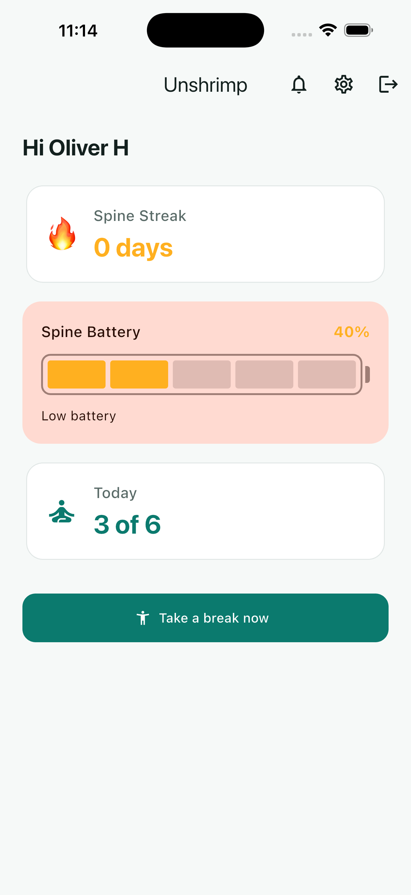
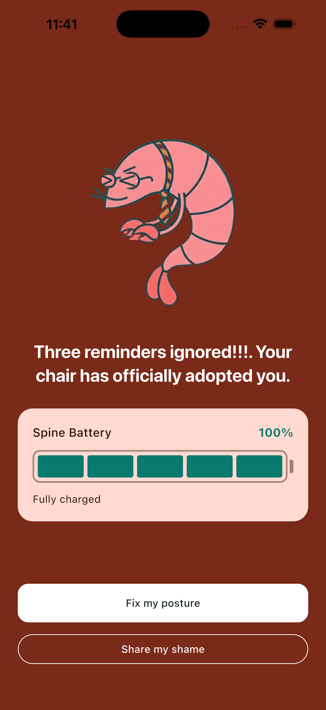

<div align="center">

<picture>
  <source media="(prefers-color-scheme: dark)" srcset="https://assets.appambit.com/logo-dark.svg">
  <source media="(prefers-color-scheme: light)" srcset="https://assets.appambit.com/logo-light.svg">
  
</picture>

# Unshrimp — AppAmbit App Starter (Flutter)

**A production-ready Flutter app powered entirely by [AppAmbit](https://appambit.com): auth, a per-user backend, offline-first sync, local reminders and analytics — with no server of your own.**

Clone it, point it at **your** AppAmbit account, create the schema, deploy the Cloud Code functions, and run.


</div>

---

## Contents

- [What this is](#what-this-is)
- [Built prompt by prompt](#built-prompt-by-prompt)
- [Quick start](#quick-start)
- [Backend setup (AppAmbit)](#backend-setup-appambit)
- [How the backend drives the app](#how-the-backend-drives-the-app)
- [What's included](#whats-included)
- [Make it yours](#make-it-yours)
- [Project structure](#project-structure)
- [Commands](#commands)
- [Troubleshooting](#troubleshooting)
- [Learn more](#learn-more)

## What this is

**Unshrimp** nags you to take posture breaks before you "shrimp" over your desk.
It is a complete, opinionated example of what you can build on AppAmbit alone — a
real product loop, not a content feed:

- **Password auth with no server**, using AppAmbit Cloud Code (passwords are
  never hashed on the client).
- **A per-user backend**: stats, settings and a notification history in an
  AppAmbit-linked SQLite database, reached only through Cloud Code functions.
- **Offline first**: a read cache so the app opens with no signal, and a
  persisted write outbox with server-side idempotency so nothing the user earns
  is lost or double-counted.
- **Local reminders** scheduled from the user's settings, a 60-second micro-break,
  a Notification Center, and the Posture Roast / Spine Battery mechanics.
- **Analytics and a Remote Config kill switch** to gate a shipped build.

Everything per-user lives server-side. Swap the AppAmbit app key for your own and
it is your backend.

<div align="center">

| Home | Posture Roast |
|:---:|:---:|
|  |  |
| *Spine Streak, Spine Battery and today's progress, from the live backend.* | *Ignore your reminders and the chair adopts you.* |

</div>

> Real captures from the iOS simulator. More screens live in
> [`docs/screenshots/`](docs/screenshots/).

## Built prompt by prompt

This starter was built on video, prompt by prompt. **Every prompt used in the
series lives in [`prompts.md`](prompts.md)**, grouped by episode — the account
system, onboarding + settings, local reminders + the 60s break + the
Notification Center, the Posture Roast + streak, and offline-first. Open it to
follow each episode and see exactly how every feature was asked for and built,
step by step.

## Quick start

**Prerequisites:** Flutter 3.41+ (Dart `^3.11`), Xcode and/or Android Studio, and
an [AppAmbit account](https://appambit.com) with **Cloud Code** and **Database**
enabled on your app.

### 1. Install

```bash
git clone <your fork> unshrimp && cd unshrimp
flutter pub get
```

### 2. Set your app key

Create **one AppAmbit app per platform** (an iOS app and an Android app). The key
is **not bundled** — it is passed at build time through the `APPAMBIT_APP_KEY`
compile-time define, using that platform's app key:

```bash
flutter run --dart-define=APPAMBIT_APP_KEY=your-app-key
```

Prefer a file? Put the key in `dart_defines/dev.json` (the `dart_defines/` folder
is gitignored) and pass it with `--dart-define-from-file`:

```json
{ "APPAMBIT_APP_KEY": "your-app-key" }
```

```bash
flutter run --dart-define-from-file=dart_defines/dev.json
```

> No key? The app shows a plain **"Missing App Key"** screen instead of starting.
> See [`.env.example`](.env.example) for the define.

### 3. Create the database schema

Link a database to your app, then run [`docs/backend/schema.sql`](docs/backend/schema.sql)
once (dashboard SQL console, or the AppAmbit MCP `execute-database-statement-tool`).
It creates `users`, `user_stats`, `user_settings`, `notifications` and
`applied_ops`. Nothing creates these at runtime — they must exist first.

### 4. Deploy the Cloud Code functions

Deploy every function in [`cloud_functions/`](cloud_functions/) to your app. For
each one the lifecycle is: **create → deploy a version → wait for build `ready`
→ activate → add an `http` trigger (slug = function name)**. Then set the
`AUTH_TOKEN_SECRET` (see below). The [cloud_functions README](cloud_functions/README.md)
lists every function's input/output.

### 5. Set the session secret

In the dashboard, set `AUTH_TOKEN_SECRET` on **every** function to the **same**
value. It signs and verifies the HS256 session. It is set per function version
and **not** inherited on re-activate, so set it again after each redeploy. Never
put it in a file or a chat — a wrong/whitespace value fails silently as
`INVALID_TOKEN`.

### 6. Run

```bash
flutter run --dart-define=APPAMBIT_APP_KEY=your-app-key
```

Register, answer the 4-question onboarding (which seeds `user_settings`
server-side), and land on Home.

## Backend setup (AppAmbit)

This is the part the React Native and .NET MAUI starters don't cover. Four
pieces make the app yours:

### Cloud Code functions

15 functions, all Node built-ins only (no npm at runtime), each verifying the
session itself. Full input/output table and the handler contract:
**[cloud_functions/README.md](cloud_functions/README.md)**. Highlights:

- **Auth** — `auth_register`, `auth_login`, `auth_refresh` (7-day JWT),
  `auth_validate`, `auth_change_password`.
- **Onboarding** — `save_onboarding` seeds settings server-side from the 4 answers.
- **Reads** — `get_user_stats`, `get_settings`, `get_notifications`,
  `get_pending_reminders`.
- **Writes** — `register_break` and `reconcile_ignored`, both **idempotent** via
  the shared `applied_ops` helper so a replayed offline flush is harmless;
  `update_settings`, `mark_all_notifications_read`, `delete_notification` (soft).

### Database schema

One file: **[docs/backend/schema.sql](docs/backend/schema.sql)**. SQLite, keyed by
the integer user id. Tables: `users`, `user_stats`, `user_settings`,
`notifications`, `applied_ops` (`purchases` is sketched for episode 6).

### Remote Config

Read by the app at startup via the SDK (`enableConfig()`). Create these keys on
your app:

| Key | Type | Default | Used for |
|---|---|---|---|
| `sarcasm_pack` | string/JSON | a neutral pack | Reminder copy shown in the local notification and the break screen. |
| `roast_lines` | JSON (array of strings) | first line, as fallback | Full-screen **Posture Roast** copy; one line is picked at random. Cached like `sarcasm_pack` so it still shows offline. Seed example in [`prompts.md`](prompts.md) (episode 4). |
| `min_supported_version` | string | *(absent = permissive)* | **Kill switch.** A running version below this shows a blocking update screen. Missing/unreadable/failed fetch → the app runs normally. |
| `entitlement_grace_days` | int | `7` | *Reserved (episode 6):* how long a last-known Pro entitlement is honoured offline. |
| `trial_days` | int | `14` | *Reserved (episode 6):* Pro trial length. |
| `pro_product_ids` | JSON | *(absent)* | *Reserved (episode 6):* store product ids. |

### CMS content

Two content types the app reads through the SDK. **Each ships a local fallback**
(`lib/features/*/repositories/fallback_*`), so the app runs before you populate
the CMS — but to make the content yours, create and seed both on your app:

| Content type | Fields | Seeds | Fallback |
|---|---|---|---|
| `onboarding_questions` | `key`, `title`, `subtitle`, `type`, options | The 4 onboarding questions, in order. | `fallback_onboarding_questions.dart` |
| `exercises` | `zone`, `title`, `steps`, `media` | The office stretch set keyed by pain zone (+ 2 wrist entries). | `fallback_exercises.dart` + bundled media in `assets/dataset/` |

The exact seed copy and values live in [`prompts.md`](prompts.md) (episode 2 for
the onboarding questions, episode 3 for the exercises) and in
[`assets/dataset/exercises.json`](assets/dataset/). Keep the CMS and the fallback
in sync so the app shows the same content online and offline.

> Verify whether your CMS stores animated GIFs before seeding `media`; if not,
> use the static `-main.webp` per exercise. The two wrist exercises have no media.

## How the backend drives the app

```
auth_register / auth_login ──► token (+ expires_at)
          │
          ├─ save_onboarding ──► user_settings  ─────► local reminder scheduler
          │                                            (active window + interval)
          ├─ get_user_stats  ──► Home (Spine Battery = roast_level,
          │                            Spine Streak, breaks today)
          ├─ get_notifications ─► Notification Center
          └─ register_break / reconcile_ignored ──► user_stats
                   ▲                                     │
                   └──── offline outbox (op_id) ◄────────┘
                         applied_ops makes a replay a no-op
```

- **Reads** go through a cache (`lib/core/cache/`): a transport failure returns
  the last payload and flips an **Offline** indicator; a function-level error
  (`INVALID_TOKEN`, `NO_SETTINGS`) still bubbles up. Entries are keyed by user id.
- **Writes** go through an outbox (`lib/core/outbox/`): a break taken offline is
  queued with an `op_id` generated at the tap, flushed on resume, and deduped
  server-side so the streak never double-counts.
- **The session** survives offline: the JWT carries its own `expires_at`, which
  the device reads to decide app-vs-Login — it never caches an auth answer.

## What's included

| Area | Where |
|---|---|
| Password auth + 7-day session, offline-aware | `lib/features/auth/` |
| 4-question onboarding that seeds settings server-side | `lib/features/onboarding/` |
| Home: Spine Streak, Spine Battery, today's progress | `lib/features/home/` |
| Settings: active window, interval, quiet mode, pause, password | `lib/features/settings/` |
| Local reminders scheduled from settings | `lib/features/reminders/` |
| 60-second micro-break | `lib/features/break/` |
| Notification Center (read / read-all / soft delete) | `lib/features/notifications/` |
| Ignored-reminder reconciliation | `lib/features/reconcile/` |
| Posture Roast | `lib/features/roast/` |
| Offline read cache + write outbox | `lib/core/cache/`, `lib/core/outbox/` |
| Remote Config kill switch | `lib/features/update_gate/` |
| Analytics events | `lib/core/analytics/` |

## Make it yours

**Required to ship as your own app:**

- **App key** — your AppAmbit app key, passed per build with `--dart-define=APPAMBIT_APP_KEY=...` (see [Quick start](#quick-start)).
- **App name** — user-visible name (currently *Unshrimp*): `pubspec.yaml`,
  Android `android/app/src/main/AndroidManifest.xml` (`android:label`), iOS
  `ios/Runner/Info.plist` (`CFBundleDisplayName`).
- **Bundle id / applicationId** — Android `com.kavaup.unshrimp`
  (`android/app/build.gradle.kts`), iOS bundle id in Xcode. The Dart package is
  `unshrimp_app` (`pubspec.yaml` `name`).
- **Icons** — replace the sources and run `dart run flutter_launcher_icons`
  (config in `pubspec.yaml`).
- **Backend** — your schema, functions and `AUTH_TOKEN_SECRET` (above).
- **Push (Android)** — drop your Firebase `google-services.json` into `android/app/` (and into `android/app/src/<flavor>/` for a flavored build); it is gitignored, never committed. iOS needs no Firebase file — AppAmbit delivers via APNs using the key you upload in the dashboard.

**Optional:** theme (`lib/core/theme/`), the reminder copy (`sarcasm_pack`),
the exercise content and onboarding questions.

## Project structure

```
lib/
  main.dart                 # calls AppBootstrap.run()
  core/
    config/                 # app-key define, SDK start, ProviderScope, root widget
    router/                 # go_router routes
    theme/                  # Material 3 light/dark palette
    cloud/                  # Cloud Code client + error types
    cache/                  # offline read cache (CachedRead)
    outbox/                 # offline write queue (op_id idempotency)
    session/                # reminder-data cleanup on logout / first run
    analytics/              # AppAmbit analytics events
  features/<feature>/       # MVVM: models/ · views/ · widgets/ · view_models/
cloud_functions/            # Cloud Code sources (deploy to your AppAmbit app)
docs/
  backend/schema.sql        # database DDL
  screenshots/              # README images
```

Each feature is MVVM; views only read/forward to a Riverpod notifier, never hold
business logic. State is Riverpod-only (**no `setState`**). Navigation is
`go_router`.

## Commands

| Command | Does |
|---|---|
| `flutter pub get` | Install dependencies |
| `flutter run` | Run on a connected device/simulator |
| `flutter analyze` | Lint / static analysis |
| `flutter test` | All Dart tests |
| `node --test 'cloud_functions/**/*.test.mjs'` | Cloud Code helper tests (Node 18+) |
| `flutter build apk` / `flutter build ios` | Release builds |
| `dart run flutter_launcher_icons` | Regenerate app icons |

## Troubleshooting

| Symptom | Fix |
|---|---|
| "Missing App Key" screen | No `APPAMBIT_APP_KEY` define was passed. Run with `--dart-define=APPAMBIT_APP_KEY=...` (see [Quick start](#quick-start)). |
| Every call returns `INVALID_TOKEN` | `AUTH_TOKEN_SECRET` mismatched or re-set needed after a redeploy — set the **same** value on every function's active version. |
| A call returns "Something went wrong" | The function has no `http` trigger. Add one (slug = function name, enabled). |
| Login/onboarding don't work | `auth_validate` / `save_onboarding` not deployed or not activated — deploy and activate them, then set the secret. |
| Home is empty but online | The schema isn't created or `get_user_stats` isn't deployed/activated. |
| Update wall appears unexpectedly | `min_supported_version` in Remote Config is above your build; lower it or clear it. |

## Learn more

- [prompts.md](prompts.md) — every prompt used in the video series, by episode
- [cloud_functions/README.md](cloud_functions/README.md) — every function's contract
- [docs/backend/schema.sql](docs/backend/schema.sql) — the database schema
- [AppAmbit docs](https://appambit.com) · [Flutter docs](https://docs.flutter.dev)

---

<div align="center"><sub>Built with Flutter + AppAmbit. Swap the app key and it's yours.</sub></div>
